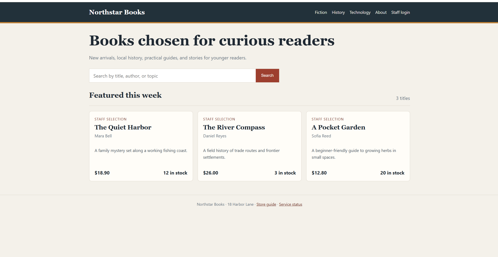
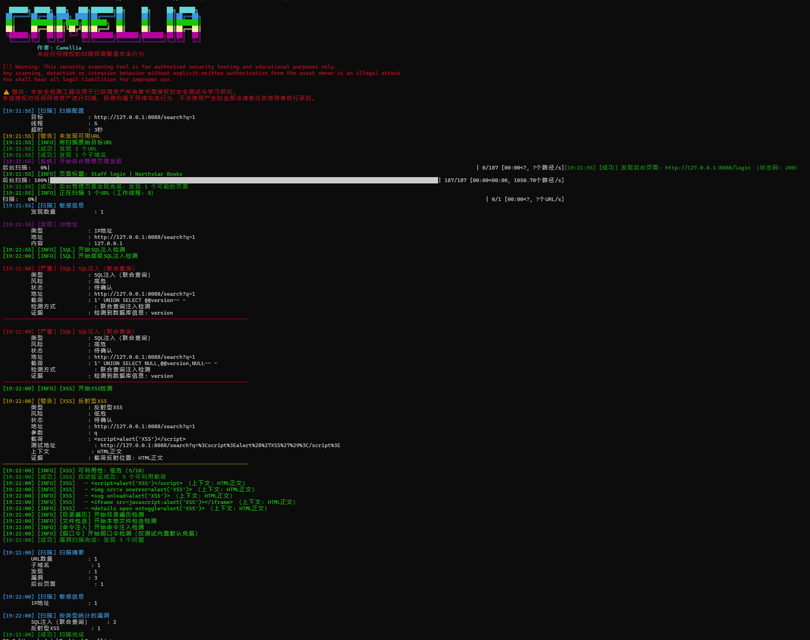

# Camellia

> 面向授权安全测试的一站式只读 Web 漏洞扫描器。

Camellia 不是只做单点 PoC 的脚本。它把目标发现、参数挖掘、漏洞验证和结果
留存串成一条完整检测链：一条命令即可完成入口发现与智能参数建模，调用多类
载荷验证风险，并将 URL、子域名、漏洞和 JSON 结果整理输出。开启 `-j` 或
`-d` 后，还可继续扩展 JavaScript、子域名与深度目标发现。

```powershell
python camellia.py -u https://example.com
```

只提供目标 URL、不指定扫描模块时，Camellia 会自动启用 `--vuln-scan`，
直接进入完整只读 Web 检查。

## 克隆项目

```powershell
git clone https://github.com/camellia-haven/Camellia.git
cd Camellia
```

GitHub 仓库：https://github.com/camellia-haven/Camellia

## 界面预览

### 本地漏洞实验站



### 实际扫描输出



## 为什么是 Camellia

- **一条命令，完整链路**：发现、测试、验证、归类、导出一次完成。
- **不只测试显式参数**：从 HTML、JavaScript、URL 拼接和常见参数变体中寻找入口。
- **SQL 检测覆盖完整**：布尔、时间、报错、联合查询与响应差异分析联动。
- **验证优先，减少误报**：支持基线对照、响应差异、增强验证和上下文匹配。
- **证据可留存**：URL、子域名、漏洞报告和 JSON 结果均可独立导出。
- **默认只读**：不导出数据库、不上传文件、不反弹 Shell、不执行任意命令。

## 核心能力

| 模块 | 能力 |
| --- | --- |
| SQL 注入 | 布尔盲注、时间盲注、报错注入、联合查询、响应差异检测、WAF 绕过载荷、可选 sqlmap 信息枚举 |
| XSS 检测 | 反射检测、上下文识别、载荷可利用性验证、自定义载荷 |
| 文件与路径 | 只读目录遍历、本地文件包含检测 |
| 命令注入 | 使用固定 `id` 命令进行无副作用验证 |
| 弱口令检测 | 自动识别登录表单并测试少量内置默认口令 |
| 后台发现 | 常见管理路径发现、自定义后台字典 |
| 目标发现 | 页面链接、JavaScript 文件、子域名、深度目标发现 |
| 参数发现 | HTML 表单、JavaScript、URL 拼接、隐藏参数、相似参数和参数变体 |
| 组件漏洞 | 本地目录、文件、SBOM 或远程文件调用 `cve-bin-tool` |
| 结果输出 | 终端分阶段输出、URL 列表、子域名列表、漏洞报告、JSON、HTTP 响应与网页截图 |

## 扫描流程

1. **目标发现**：抓取页面、JavaScript、关联链接和子域名。
2. **参数建模**：识别表单、查询参数、隐藏字段、拼接模式及相似参数。
3. **载荷检测**：按所选模块执行 SQL、XSS、文件、命令和弱口令等检查。
4. **差异验证**：结合响应状态、长度、内容和时间差异减少误报。
5. **结果留存**：汇总发现并通过多种格式输出，方便复核与归档。

## 安装

```powershell
python -m pip install requests beautifulsoup4 tqdm colorama urllib3
```

## 快速开始

```powershell
# 默认执行完整只读漏洞扫描
python camellia.py -u https://example.com

# 只测试 SQL 注入和反射型 XSS
python camellia.py -u "https://example.com/search?q=test" --sql-scan --xss-scan

# 测试目录遍历和本地文件包含
python camellia.py -u "https://example.com/download?file=guide.txt" --path-traversal-scan --file-inclusion-scan

# 登录表单弱口令检测
python camellia.py -u https://example.com/login --weak-password-scan

# 完整扫描并输出 JSON 与漏洞报告
python camellia.py -u https://example.com -oj result.json -ov vulnerabilities.txt
```

Windows 下也可以使用 `py`：

```powershell
py camellia.py -u https://example.com
```

查看全部参数：

```powershell
python camellia.py --help
```

## CVE 组件扫描

```powershell
# 扫描本地应用目录
python camellia.py --cve-scan ./application

# 使用本地漏洞库并输出 JSON
python camellia.py --cve-scan ./application --cve-offline -oj cve.json

# 下载授权目标提供的组件文件后扫描
python camellia.py --cve-scan https://example.com/app.jar --yes
```

CVE 扫描支持通过 `--cve-bin-tool-path` 指定本地组件扫描程序路径，也可以从
官方 GitHub Releases 获取可执行文件。

## sqlmap 联动

启用 `--auto-sqlmap` 后，Camellia 可以利用 sqlmap 枚举数据库、当前数据库、
当前用户和 DBA 权限。`--dump` 与 `--dump-all` 会被主动拦截，工具不会导出
业务数据。

```powershell
python camellia.py -u "https://example.com/item?id=1" --sql-scan --auto-sqlmap
```

## 安全边界

Camellia 的设计目标是把验证所需的行为限制在可控范围内：

- 不上传文件。
- 不导出数据库内容。
- 不执行反弹 Shell。
- 不提供任意系统命令执行入口。
- 命令注入检测只执行固定的 `id` 命令。
- 远程扫描前显示授权警告并要求确认。
- 支持通过 `--yes` 在已获得书面授权的自动化流程中跳过交互确认。

这些限制降低了测试行为对目标的影响，但不会替代授权、范围和测试窗口的约束。

## 典型场景

- 资产所有者对自有 Web 服务进行上线前安全自检。
- 授权渗透测试中进行 Web 入口梳理和常见漏洞预检。
- 安全实验室验证检测规则、载荷和响应差异逻辑。
- 软件供应链场景中扫描本地应用和组件文件。

## 项目结构

```text
.
├── camellia.py
├── camellia_core/
│   ├── args.py
│   ├── cli.py
│   ├── core.py
│   ├── scan.py
│   ├── network.py
│   ├── params.py
│   ├── xss.py
│   ├── file_scan.py
│   ├── command_scan.py
│   ├── weak_password_scan.py
│   ├── cve_scan.py
│   └── runtime.py
├── docs/
│   └── images/
├── 测试环境/
├── .gitignore
└── README.md
```

## 本地漏洞实验环境

`测试环境/` 是仅绑定 `127.0.0.1` 的本地书店实验站，用于验证扫描与检测
逻辑。它使用 Node.js 内置的 `node:sqlite` 和 HTTP 模块，没有第三方 npm
依赖，不需要执行 `npm install`。

### 环境要求

- 建议使用 Node.js 24 或更高版本。
- 扫描器依赖已按“安装”章节完成安装。

检查 Node.js 是否可用：

```powershell
node --version
npm --version
```

### 启动实验站

打开第一个 PowerShell 终端，从项目根目录启动：

```powershell
cd .\测试环境
npm start
```

也可以直接运行：

```powershell
node server.js
```

看到本地监听提示后，保持该终端窗口运行，在浏览器访问：

```text
http://127.0.0.1:8088/
```

默认端口被占用时，可以指定其他端口：

```powershell
node server.js --port 8090
```

此时访问 `http://127.0.0.1:8090/`。要停止实验站，在运行服务的终端中按
`Ctrl+C`。

### 可用测试路由

| 路由 | 测试用途 |
| --- | --- |
| `/catalog?genre=fiction` | SQL 支持的图书分类筛选 |
| `/search?q=books` | 图书搜索与反射型输出 |
| `/download?file=guide.txt` | 文档读取与路径处理 |
| `/status/host?host=127.0.0.1` | 本地主机诊断 |
| `/login` | 员工登录与默认口令检测 |
| `/about` | 用于误报对照的正常页面 |

### 扫描本地实验站

保持实验站运行，再打开第二个 PowerShell 终端，从项目根目录执行：

```powershell
python camellia.py -u "http://127.0.0.1:8088/search?q=books" --yes
```

也可以直接进行完整扫描：

```powershell
python camellia.py -u "http://127.0.0.1:8088/" --yes
```

### 运行环境自检

```powershell
python -B .\测试环境\verify_vulnerable_lab.py
```

实验站只应运行在本机。不要把监听地址修改为公网地址，也不要在未授权的网络
环境中暴露该服务。

## 后续路线

- 扩展 POST、JSON API 和 GraphQL 请求体检测。
- 增加 RFI、SSRF、IDOR 等授权场景下的只读检查。
- 增强开放式目标发现、请求导入和扫描任务配置。
- 增加 HTML、Markdown 等更适合交付的报告格式。
- 持续扩充参数发现来源、载荷变体和误报验证策略。

路线图代表计划方向，不代表当前版本已经支持。

## 免责声明

Camellia 仅用于已获得资产所有者明确书面授权的安全测试、教学研究和个人
自有环境验证。未经授权对任何网络资产进行扫描、探测或测试，都可能构成违法
攻击行为。使用者应自行确认授权范围，并对不当使用产生的全部后果负责。
